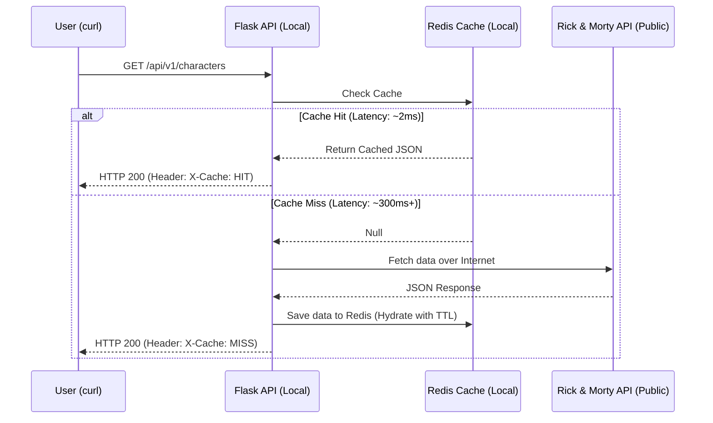

# Part 3: Building the App & Caching for Data Latency

*Navigation: ← [Part 2: Optimizing Dockerfiles with Multi-Stage Builds](./part-2-optimizing-dockerfiles-with-multi-stage-builds.md) | [Part 4: Full-Cycle CI/CD — From Local Hooks to AWS ECR](../drafts/part-4-full-cycle-cicd.md) →*

## Key Takeaways

**Platform engineers:** Standardise your cache connection patterns. Always use a middleware to automatically generate deterministic cache keys for GET requests.

**SREs on-call:** Stop silent cascading failures. If your upstream provider goes down, a stale cache fallback prevents your app from crashing.

**First-timers:** Understand the app flow first. Don't fetch the same data twice. If a user asks for character data, fetch it once, store it in Redis, and serve subsequent requests instantly.

---

## How Our Application Works

Our application is a Python **Flask REST API**. Its primary job is to aggregate data from the external Rick & Morty API (`https://rickandmortyapi.com/api`). Specifically, our business logic filters the data to return characters matching strict criteria: `species=human`, `status=alive`, and `origin=earth`.

Here is the core structure you will find in `app.py`:

```python
from flask import Flask
from src.cache.detection import CacheMiddleware
from config import get_cache_backend

app = Flask(__name__)

# Initialize our custom cache middleware
cache_backend = get_cache_backend()
cache_middleware = CacheMiddleware(app, cache_backend)
```

We keep it simple, but we rely heavily on an external upstream API. This introduces a major operational risk: **Data Latency**.

---

## The Mental Model

When a user requests data, the naive flow is: 
`User -> Our Flask App -> Upstream Rick & Morty API -> Our Flask App -> User`. 

This has two severe problems:
1. **High Latency:** We pay the network penalty of reaching out to the public internet on *every single request* (often 300ms+).
2. **Rate Limiting & Outages:** If the upstream API rate-limits us or goes offline, our application fails immediately.

To solve this, we introduced the **CacheMiddleware** backed by Redis.

Here is the architectural flow of a request:



The new mental model is a layered check:
1. **The Cache Check** — The middleware asks Redis: "Do we have this data?" (Latency: ~2ms).
2. **The Upstream Fetch (Cache Miss)** — If Redis says no, we fetch from the public API (Latency: ~300ms).
3. **The Cache Hydration** — We store the upstream response in Redis with a Time-To-Live (TTL).
4. **The Client Response** — We return the data to the user and inject headers showing `X-Cache: HIT` or `MISS`.

---

## Walkthrough: Implementing the Cache Detector

If you look at [`src/cache/detection.py`](https://github.com/spmahapatra/rick-morty-api-helm/blob/main/src/cache/detection.py) in our repository, you will see how we intercept requests before they hit our business logic. 

### 1. Generating Deterministic Cache Keys

We must uniquely identify every request to store it correctly. We generate a cache key based on the HTTP method, endpoint, and query parameters:

```python
class CacheDetector:
    def generate_cache_key(self, endpoint, method, query_params=None):
        """Generate deterministic cache key from request"""
        # Example output: "GET:get_characters:species=human&status=alive"
        key_base = f"{method}:{endpoint}"
        if query_params:
            sorted_params = "&".join(f"{k}={v}" for k, v in sorted(query_params.items()))
            key_base = f"{key_base}:{sorted_params}"
        
        # We hash the key to ensure it is always a safe length for Redis
        return hashlib.md5(key_base.encode()).hexdigest()
```

### 2. The Middleware Interception

The `CacheMiddleware` hooks into Flask's `before_request` and `after_request` lifecycle. 

- **Before Request:** It generates the key and checks Redis. If data exists, it returns it immediately, entirely bypassing the upstream API.
- **After Request:** If the request had to hit the upstream API, this hook captures the response payload and saves it into Redis for the next user.

### 3. Graceful Degradation

If Redis crashes, our application must not crash. We wrap our cache connection in `try/except` blocks. If Redis is unreachable, we simply log a warning and fall back to fetching data directly from the upstream API.

---

## Advanced Caching Strategies

### The Thundering Herd Problem

**Symptom:**  
When a highly requested cache key expires (like a popular character or homepage data), 100 concurrent requests miss the cache at the exact same millisecond. They all hit the upstream API simultaneously, causing a rate limit block or an upstream crash.

**Root Cause:**  
Because the key is gone, all application threads independently decide they need to fetch and hydrate the cache.

**Fix (Soft TTL / Background Refresh):**  
Instead of waiting for a hard TTL expiration, implement a "Soft TTL". 
Store the data alongside an expiration timestamp. When a request comes in, check if the Soft TTL has passed. If it has, immediately return the *stale* data to the user, but spawn a background thread (using Celery or FastAPI BackgroundTasks) to fetch fresh data and update the cache. This ensures only *one* thread hits the upstream API, while users never experience the 300ms latency penalty.

### Memory Eviction Policies

If you cache everything endlessly, Redis will run out of memory (OOM). You must configure an eviction policy in your `redis.conf`.
For an API cache, `allkeys-lru` (Least Recently Used) is usually the best choice. When Redis hits its memory limit, it will automatically delete the cache keys that haven't been accessed recently, making room for new data while keeping the most popular characters in memory.

## Walkthrough: Running and Testing the App Locally

This application is designed as a drop-in reference architecture. If you need a fully-functional, containerised application to test your local Kubernetes clusters, CI/CD pipelines, or logging stacks, you can use this repository as your baseline. 

Here is exactly how to deploy it, query it, and validate the caching mechanism locally.

### 1. Start the infrastructure
Clone the repository and spin up the Flask application alongside the Redis cache:
```bash
git clone https://github.com/spmahapatra/rick-morty-api-helm
cd rick-morty-api-helm
docker compose up -d
```
This starts two containers: your `api` service (exposed on port 5000) and your `redis` cache backend.

### 2. Query the API
Use `curl` or Postman to request the character data. The first request will take longer as the app reaches out to the upstream provider:
```bash
curl -i http://localhost:5000/api/v1/characters
```
Look closely at the HTTP response headers. You will see `X-Cache: MISS`.

### 3. Validate the cache
Run the exact same `curl` command again. The response should return almost instantly:
```bash
curl -i http://localhost:5000/api/v1/characters
```
The response headers will now show `X-Cache: HIT`, proving that the data was served directly from your local Redis container, completely bypassing the public internet.

### 4. Inspect Redis directly (Optional)
If you want to validate the raw JSON payloads stored in memory, you can connect directly to the Redis container using `redis-cli`:
```bash
docker exec -it redis-cache redis-cli
127.0.0.1:6379> keys *
127.0.0.1:6379> get "<paste-your-cache-key-here>"
```

---

## Debugging & Common Pitfalls

**Pitfall 1: Unhandled Redis connection timeouts**
- **Symptom:** The Flask application crashes with a `ConnectionError` when Redis is rebooted.
- **Fix:** Always wrap your `redis.get()` calls in a `try/except` block. If the cache is unreachable, log the error and degrade gracefully by fetching directly from the upstream API.

**Pitfall 2: Non-deterministic cache keys**
- **Symptom:** Users request `?status=alive&species=human` and `?species=human&status=alive`, but the cache treats them as two different misses, duplicating data.
- **Fix:** Sort query parameters alphabetically before hashing them to guarantee the exact same cache key for logically identical requests.

---

## FAQ

### Why use Redis instead of a local Python dictionary?
If we scale our Flask app to 5 containers, a local dictionary means we have 5 separate, unsynchronised caches. Redis provides a centralised, shared cache for all containers, ensuring consistent data and memory efficiency.

### What happens to data freshness?
We enforce a strict Time-To-Live (TTL) on our Redis keys. Once the TTL expires, the key is evicted, forcing the next request to fetch fresh data from the upstream API. This balances low latency with eventual consistency.

### How do I bypass the cache during testing?
You can build a backdoor into your middleware. Look for a specific header like `Cache-Control: no-cache` in the incoming request, and if present, force the app to skip the Redis check and go straight to the upstream API.

### Can I deploy this test app to Kubernetes?
Kubernetes manifests and Helm chart packaging are scheduled for **Part 5** of this series. For now, run and test the application locally using Docker Compose (`docker compose up -d`).